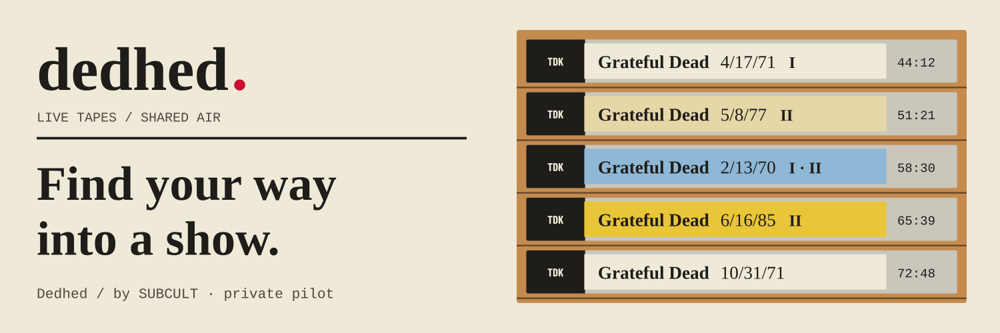

# Dedhed



**Pull a tape off the shelf, or tune in to what everyone else is hearing.**

Dedhed is a concert-tape library for Grateful Dead recordings from Internet Archive, with a shared radio station. Date, venue, recording credits and source notes stay on the label.

It is a limited public pilot. Two reviewed audience recordings can be played, Fillmore East and Barton Hall; the rest of the show index is metadata only. The tapes in the banner are sample labels, not a list of what you can play.

Public pilot: https://dedhed.subcult.tv

## Features

- **Play a tape.** Pick a reviewed recording and play a whole show or a single set. Pause, seek and track changes affect only your playback.
- **Tune in.** The station follows its own saved schedule, so every listener joins the same program at the same point instead of starting their own copy.
- **Read the label.** Credits, track order and uncertain set boundaries stay visible.
- **Show index.** Browse the collection by calendar, open a date page, see "On this day" across years, or search the whole index. An entry in the index does not mean the recording can be played.
- **Favorites and sharing.** Favorites are saved in your browser. Share links have a copy fallback and social compose links.

## Quick start

Requirements: Go 1.26 or later, Node.js 24, pnpm 10.33.0 and PostgreSQL 17.

Copy [`.env.example`](.env.example) to `.env` and point `DATABASE_URL` at a disposable database. The backend does not read `.env` itself, so export it first. Then, from `backend/`:

```sh
set -a; . ../.env; set +a
go run ./cmd/dedhed migrate
go run ./cmd/dedhed seed
go run ./cmd/dedhed serve
```

`seed` loads clearly labeled synthetic test tones, not real concerts, and does not replace an existing station schedule. In another shell:

```sh
pnpm --dir web install --frozen-lockfile
pnpm --dir web dev
```

Vite serves the app on port 5173 and forwards `/api` to `127.0.0.1:8080`. Set `DEDHED_API` to use another API origin.

Checks:

```sh
make verify             # source pins, doc links, Python tests, Go format/vet/race tests/build, web typecheck/lint/tests/build
make test               # Go and web tests only
make test-integration   # database tests; needs a disposable TEST_DATABASE_URL
```

## API

All public HTTP routes are read-only. Changes go through the `dedhed` CLI.

| Route | Purpose |
| --- | --- |
| `GET /api/health`, `GET /api/ready` | Process health and database readiness |
| `GET /api/recordings`, `GET /api/recordings/{id}` | Playable recordings and their tracks |
| `GET /api/audio/{id}` | Audio for a reviewed track |
| `GET /api/station` | The station's current program and position |
| `GET /api/shows`, `GET /api/calendar`, `GET /api/dates/{date}`, `GET /api/on-this-day` | Show index, calendar, date pages and On this day |

The CLI commands are `migrate`, `seed`, `discover`, `inventory-scrape`, `inventory-fetch`, `inventory-import`, `import`, `review`, `public-review`, `public-schedule`, `media`, `schedule`, `report` and `serve`. Source discovery fetches metadata only. Audio is acquired only for recordings that have been reviewed, by the separate `scripts/acquire.py` tool.

## Configuration

| Variable | Purpose |
| --- | --- |
| `DATABASE_URL` | PostgreSQL connection string |
| `API_ADDR` | Listen address for `serve` |
| `DEDHED_MEDIA` | Folder of acquired audio |
| `DEDHED_MIGRATIONS` | Folder of SQL migrations |
| `DEDHED_REVISION` | Revision string reported by the server |
| `VITE_DEDHED_AUDIENCE` | Web build audience, `private` by default |

## Deploy

The repository builds two images:

- [`backend/Dockerfile`](backend/Dockerfile): the `dedhed` binary and migrations. It runs `dedhed serve` on port 8080 and reads audio from `/media`.
- [`web/Dockerfile`](web/Dockerfile): the static frontend on nginx. Pass `--build-arg VITE_DEDHED_AUDIENCE=public` for a public build.

Run `dedhed migrate` against your database before starting the API, mount the media folder, and serve the frontend over HTTPS with `/api` proxied to the API. Keep audio and database state outside the repository.

The frontend can also run against SUBCULT's shared archive engine instead of the bundled Go API. [`deploy/core-compose.yml`](deploy/core-compose.yml) and the pinned image in [`deploy/archive-core.env`](deploy/archive-core.env) describe that setup.

## Project layout

```text
backend/     Go API and CLI (cmd/dedhed, internal/)
web/         React and Vite frontend
migrations/  SQL migrations
scripts/     Source checks, audio acquisition, recovery and monitoring tools
deploy/      Shared-engine Compose file and version pins
docs/        Design system, plans and reference notes
```

## Contributing

- Bugs and feature requests: [GitHub issues](https://github.com/subculture-collective/dedhed/issues).
- Questions and ideas: [GitHub Discussions](https://github.com/subculture-collective/dedhed/discussions).
- Code: pull requests on GitHub against `main`. CI runs `make verify` with its own PostgreSQL 17 database and builds the public frontend image on every pull request. Both must pass.

## License

The source code is licensed under GPL-3.0-only. See [LICENSE](LICENSE). The license does not cover the recordings, which keep their own terms. Dedhed is an independent project and is not endorsed by the Grateful Dead or the tapers.
