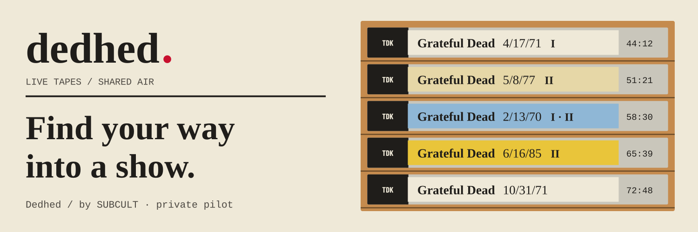

# Dedhed

> Free two-recording public pilot: [dedhed.subcult.tv](https://dedhed.subcult.tv).

**Pull a tape off the shelf, or tune in to what everyone else is hearing.**

Dedhed is a Grateful Dead concert-tape library with on-demand shows and sets,
plus a shared radio schedule. Date, venue, recording credits and source notes
stay on the label.

**The owner approved a free public pilot with the reviewed Fillmore East and Barton Hall audience recordings.** Its [release runbook](docs/runbooks/public-pilot.md) records the exact scope, public approval controls and withdrawal procedure. The pilot is deployed on Almaz. Complete HTTPS audio delivery and an independent restore passed; daily natural maintenance and longer stability remain under observation. See the [public release evidence](docs/reports/public-pilot-2026-10-04.md).

## Two ways to listen

Pick a reviewed recording and play a set or a whole show. Your pause, seek and
track changes affect your playback only.

Or choose **Tune in**. The station follows its own persisted schedule, so
listeners join the current program instead of starting a separate copy.

## Read the label

A metadata-only show index supports calendar browsing, date pages, On this day
and collection-wide search. An entry in that index does not mean the recording
is available to play. Playback is limited to reviewed recordings.

Credits, track order and uncertain set boundaries remain visible. The tapes
shown in the banner are sample labels, not a promise of those recordings in
the pilot. Development previews use clearly labeled synthetic test tones.

## About the pilot

Real listening qualification and public relay are separate decisions; source
availability does not grant permission to rebroadcast a recording.

The [pilot evidence report](docs/reports/private-pilot-2026-10-02.md) records
qualification and open listening criteria. The [roadmap](ROADMAP.md) and
[Gitea issues](https://git.subcult.tv/subculture-collective/dedhed/issues) track
the remaining work. Setup and verification are in
[DEVELOPMENT.md](DEVELOPMENT.md).

Built by [SUBCULT](https://subcult.tv). Source code is
[GPL-3.0-only](LICENSE); that license does not cover acquired audio. Dedhed is
an independent project and does not imply official endorsement.

The original frontend remains in this repository. A versioned headless Arkhiv
engine can serve it through the [shared-core release runbook](docs/runbooks/shared-core-release.md),
with an immutable pin and independently verified upgrades.

## Viewer feedback, October 6

The product independently pins shared viewer 0.3.1. Its native backend and core
pins remain independent. Browser favorites are scoped to this product or selected
collection and retain removable unavailable references. Sharing has a selectable
copy fallback and social compose links. Optional account activation requires a
verified native-to-canonical identity mapping and a separate provider decision.
No acquisition, approval or deployment changes are included.

The [viewer qualification report](docs/reports/viewer-feedback-2026-10-06.md) records local verification and browser evidence.
